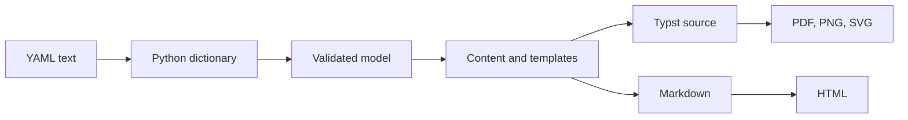

# Understanding RenderCV

RenderCV turns a text description of a CV into a typeset document. You write the content in YAML; RenderCV checks it and writes Typst code; Typst lays out the pages and produces the PDF.



Each step turns the same CV into a different form, and each form suits one job: YAML is easy for people to write, a validated model is safe for Python to rely on, and Typst code is what the layout engine reads. Because the steps are separate, a layout can change without touching, for example, how dates are checked.

## Reading YAML

YAML is a way to write structured information as plain text. Indentation shows what belongs to what, and a dash starts a list item:

```yaml
cv:
  name: John Doe
  location: London
```

To a program, that's only a sequence of characters. A **parser** reads the characters and builds values the program can work with, here a Python **dictionary**, which stores values under names:

```python
{"cv": {"name": "John Doe", "location": "London"}}
```

Python can't read YAML by itself, so RenderCV uses the [ruamel.yaml](https://yaml.dev/doc/ruamel.yaml/) package in [`yaml_reader.py`](https://github.com/rendercv/rendercv/blob/main/src/rendercv/schema/yaml_reader.py). ruamel.yaml also remembers the line each value came from, so an error message can point to the exact line in your file.

A CV can be spread over several files: the main CV file, separate design, locale, and settings files, and **overlays**, small files that change a few values, for example to swap in a private phone number. The model builder combines them in order and then applies command-line options such as `--cv.name`. When two sources set the same thing, the later one wins: dictionaries are combined name by name, while a list or a single value is replaced as a whole. Checking happens after combining, so it checks exactly what will be rendered.

## Validating the data

Parsing tells us what the file says. **Validation** checks that it makes sense for RenderCV: a name must be text, a date must exist on the calendar, and an end date can't come before its start date. Finding these problems first lets RenderCV say exactly what is wrong and where, instead of failing halfway through the layout.

[Pydantic](https://docs.pydantic.dev/latest/) checks data against a description written as Python classes. Here is a small example, separate from RenderCV's real models:

```python
from pydantic import BaseModel


class Person(BaseModel):
    name: str
    location: str | None = None


person = Person.model_validate({"name": "John Doe"})
assert person.name == "John Doe"
assert person.location is None
```

`name: str` says a name is required and must be text. `location: str | None = None` says a location may be text or absent, and becomes `None`, Python's "no value", when absent. `model_validate` checks a dictionary against these rules and returns an object; invalid input raises an error naming the field. Rules involving several values, such as the order of two dates, are written as extra validator functions.

RenderCV's [`RenderCVModel`](https://github.com/rendercv/rendercv/blob/main/src/rendercv/schema/models/rendercv_model.py) has four fields: `cv`, `design`, `locale`, and `settings`. Each one is another Pydantic model, so validation works its way down to every entry and setting. Rules that involve more than one of the four belong on `RenderCVModel` itself.

Validation also prepares what the input refers to: it checks that a local photo exists, downloads a photo given as a web address, and checks the syntax of custom templates. Paths written in the YAML are relative to the main CV file's folder; paths given on the command line are relative to the folder you run the command from.

This is the most important boundary in RenderCV. Every problem with the input must be found during validation and reported clearly. Once validation succeeds, the renderer must produce the files. If it fails anyway, RenderCV has a bug, and the error is left to show as one instead of being disguised as a problem with the input.

## Understanding formatted content

Every text field can use Markdown, a lightweight way to mark formatting: `**Published** [three papers](https://example.com)` means the word "Published" in bold, followed by a link. Typst marks formatting differently, so the text can't simply be copied over.

RenderCV first works out what the formatting means. [markdown-it-py](https://markdown-it-py.readthedocs.io/) parses the text, and [`markup.py`](https://github.com/rendercv/rendercv/blob/main/src/rendercv/renderer/templater/markup.py) stores the result as a **tree**, a structure in which each piece contains smaller pieces: a bold piece contains the word "Published", and a link piece contains its text and its address. Pieces are never changed in place; a change builds new pieces, so no step can accidentally alter what another step sees. Extra parser rules also recognize Typst code and `$$math$$` written directly in a field.

Working on this structure instead of raw text makes changes precise. Keyword bolding can bold the visible word "Python" without touching a link address that happens to contain "python". Entry templates can fill in fields: in `**COMPANY**, POSITION`, a missing position also removes the comma before it.

Finally, a writer turns the tree into Typst or Markdown text. Along the way it **escapes** characters the target language would otherwise read as instructions. In Typst, `#` starts code, `$` starts math, and `*` makes text bold, so a CV saying "C# and $5M" becomes `C\# and \$5M`: the backslash tells Typst to print the character itself. Characters with no special meaning in Typst, such as `%`, are written as they are. [`model_processor.py`](https://github.com/rendercv/rendercv/blob/main/src/rendercv/renderer/templater/model_processor.py) builds a separate `RenderContext` for each output format, with dates, labels, and formatted fields ready to insert. Its entries are read-only mappings, so custom fields remain available to Jinja. Rendered strings never enter the validated schema models; rendering twice or in another format cannot alter the original CV.

## Assembling a document with templates

A **template** is text with gaps for values, plus instructions for parts that are optional or repeated. [Jinja](https://jinja.palletsprojects.com/) fills the gaps. This simplified template:

```jinja2
= {{ cv.name }}

{{ cv.location }}

```

produces this when the name is John Doe and the location is London:

```typst
= John Doe
London
```

`{{ ... }}` inserts a value, and `` includes its text only when the condition holds. Python prepares the values; the templates decide where they go.

[`templater.py`](https://github.com/rendercv/rendercv/blob/main/src/rendercv/renderer/templater/templater.py) assembles the document setup, the header, the sections, and the entries. A subsection is drawn by the same code as a section, one heading level deeper. RenderCV looks for templates in your CV's folder first and falls back to the built-in ones, so you can [change a layout](../user_guide/how_to/override_default_templates.md) without editing RenderCV itself.

HTML has special characters too: a `<` in a title must appear as text instead of starting a tag. Jinja escapes values in HTML templates automatically. The page body, which RenderCV has already turned into HTML, is marked with Jinja's `safe` filter so that its tags stay tags. `safe` only switches escaping off; it doesn't check that the HTML is harmless.

## Turning Typst code into pages

[Typst](https://typst.app/) is a language for describing documents: their text, styles, and layout. Its **compiler** reads that description, works out where everything goes on each page, and writes the result as a PDF or as images. In the template above, `= John Doe` describes a heading.

The `typst` Python package lets Python run that compiler. [`pdf_png.py`](https://github.com/rendercv/rendercv/blob/main/src/rendercv/renderer/pdf_png.py) hands it the generated code, the fonts, and the Typst packages the themes import, which all ship with RenderCV, so rendering needs no network. The code is passed in memory, so turning off the saved `.typ` file doesn't stop the PDF from being produced. PNG and SVG output contain one image per page. HTML doesn't come from Typst; it is generated from the Markdown output.

[`run_rendercv.py`](https://github.com/rendercv/rendercv/blob/main/src/rendercv/cli/render_command/run_rendercv.py) runs these steps in order and reports progress. In watch mode it runs them again whenever an input file changes. Follow that function to see how the pieces connect; [Testing](testing.md) explains how we check that they work.
